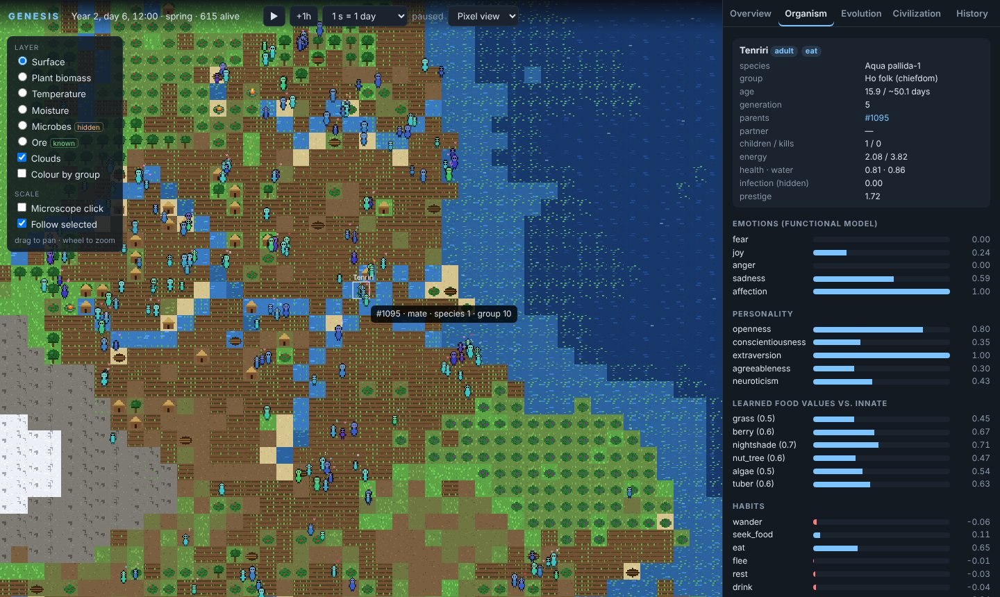
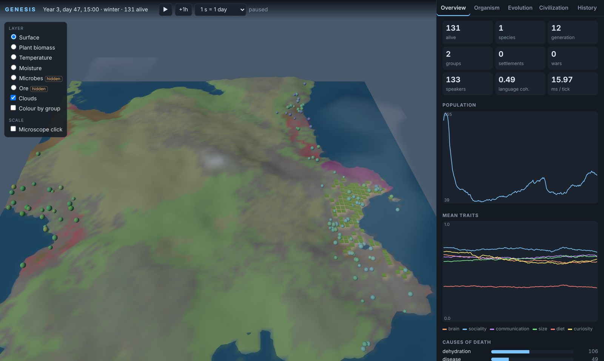

# GENESIS — искусственная эволюционирующая вселенная

Экспериментальная модель мира, в котором организмы рождаются, воспринимают среду, учатся, общаются,
размножаются, стареют и умирают, а эволюция, язык, орудия, поселения и верования **могут** возникнуть
из взаимодействия простых правил. Ничего из истории мира не прописано заранее и ничего не гарантировано.





## Быстрый старт

```bash
pip install -e ".[test]"
genesis serve --scenario advanced --seed 2 --population 250   # затем откройте http://127.0.0.1:8000
```

Другие команды:

```bash
genesis serve                                   # первичный мир: простые первые организмы
genesis run --ticks 20000 --seed 1              # без интерфейса, с отчётом о «первых событиях»
genesis run --scenario advanced --ticks 15000 --save world.pkl
genesis compare --ticks 3000 --seeds 1 2 --frameworks none quran_inspired egoist
python scripts/demo_report.py                   # длинные демонстрационные прогоны → docs/DEMO_RESULTS.md
pytest                                          # 61 тест
```

Зависимости: Python ≥ 3.10, NumPy, FastAPI, Uvicorn. Three.js поставляется в `genesis/web/vendor`
(работает без интернета).

## Что есть в мире

* **Планета:** рельеф, суша и море, реки и озёра (вода стекает с гор по рельефу), температура по широте/высоте/сезону/времени суток, ветер, облака, дождь,
  влажность почвы, бури, лесные пожары от молний, затмения, похолодания, 6 видов растений (одни ядовиты,
  у других энергия «заперта» и доступна только с навыком), разложение и плодородие, камни, глина, песок,
  руды под землёй, микробы (невидимы), небо (луна, планеты-«странники», звёзды). Ограниченные пространство и ресурсы.
* **Организмы:** уникальный id и имя, геном из 27 генов + генетически заданная нейросеть 16→8→12,
  энергия, тело, растущее с возрастом, здоровье, жажда, иммунитет, продолжительность жизни, возраст и стадии
  (младенец, ребёнок, подросток, взрослый, старик).
* **Эволюция:** наследование, кроссинговер, мутации (с эволюционирующей частотой), естественный отбор,
  видообразование с репродуктивной изоляцией, филогения. Реальные компромиссы: мозг дорог, крупное тело
  требует больше пищи, долгая жизнь означает позднее взросление.
* **Обучение и память:** вкусовое отвращение, страх по внешности, места еды/воды/опасности, привычки,
  кратковременная и долговременная память с забыванием, планирование для крупного мозга.
  Генетически идентичные близнецы в разных условиях ведут себя по-разному (тест).
* **Социальное:** индивидуальные асимметричные отношения, забота о детях, кормление, обмен едой
  (родственный отбор, взаимность, милосердие), пары, санкции против агрессоров, ритуалы.
* **Язык:** слова изобретаются случайно и распространяются в «игре в именование» (Steels);
  общий словарь группы возникает или не возникает. Слова полезны, потому что передают знания о еде, воде и опасности.
* **Химия и тепло:** материалы состоят из элементов, свойства вычисляются из состава; температура огня
  зависит от топлива и очага; обжиг, уголь, медь, железо и стекло возможны только при достигнутой
  температуре; вещество сохраняется; CO₂ и парниковый эффект.
* **Орудия и наука:** 16 аффордансов (колоть орехи, оббивать камень, копать, огонь, укрытие, земледелие,
  гончарство, древесный уголь, печь, горн, металл, стекло, микроскоп, телескоп, письменность, хранение еды в ямах) открываются **только экспериментом** с
  реально присутствующими предметами и передаются обучением.
* **Цивилизация:** группы, поселения, торговые связи, вражда и мир, типология band → tribe → chiefdom → state —
  всё *обнаруживается* по поведению.
* **Скрытые уровни реальности:** подземный, микроскопический, небесный. Они действуют с первого тика,
  но становятся известны жителям только через исследование.
* **Нравственный модуль:** настраиваемые воспитательные идеалы для сравнительных экспериментов, включая
  профиль, вдохновлённый Кораном (справедливость, милосердие, терпение, ответственность, правдивость,
  прощение, благодарность). По умолчанию ничего не навязывается.

## Панель наблюдателя

**Пиксельный вид** (по умолчанию): мир сверху в пиксель-арте. Все плитки и спрайты генерируются кодом,
без файлов-картинок. Облик существа следует из его генов: размер, окраска, плавники у водных видов,
прямохождение и крупная голова у видов с большим мозгом. Видны времена года (листопад, снег),
дождь и тени облаков, ночь со светом костров и горнов, хижины, поля, хранилища, печи. Перетаскивание
мышью — перемещение, колесо — масштаб, «Follow selected» — камера следует за выбранным существом.
Значок над головой показывает, что существо делает сейчас (ест, спит, дерётся, работает, ищет пару…).

**3D-вид** (переключатель вверху): 3D-планета (WebGL), день/ночь, облака, постройки, организмы (цвет — внешность или группа). Слои: поверхность,
биомасса, температура, влажность, микробы и руда (помечены «скрыто/известно жителям»).
Клик по организму — биография, родословная (предки/потомки), долговременная и кратковременная память,
эмоции, личность, привычки, выученные vs врождённые вкусы, навыки, словарь, отношения.
Вкладки: статистика населения и черт, причины смерти, распределение поведения, виды, группы и их словари,
поселения, известные уровни реальности, хронология «первых событий», перемотка истории, сохранение/загрузка,
создание новой вселенной. «Microscope click» — переход на микромасштаб в выбранной клетке.

Время: пауза, шаг на час, 1 с = минута / час / день / неделя / год / максимум.

## Этапы и тесты

| Этап | Содержание | Тесты |
|---|---|---|
| 1 | Планета, климат, день/ночь, погода, растения, простые организмы, LOD | `tests/test_stage1_world.py` |
| 2 | Энергия (баланс сходится), размножение, смерть с причиной, наследование, отбор, видообразование | `tests/test_stage2_evolution.py` |
| 3 | Память, обучение на ошибках, привычки; обучение реально меняет поведение | `tests/test_stage3_learning.py` |
| 4 | Отношения, группы, обмен, язык (сходимость словаря), сигналы тревоги | `tests/test_stage4_social.py` |
| 5 | Эксперименты, орудия, передача навыков | `tests/test_stage5_tools.py` |
| 6 | Поселения, торговля, полития, конфликты и мир | `tests/test_stage6_civilization.py` |
| 7 | Ограниченное восприятие, скрытые уровни, микромир, пассивность наблюдения | `tests/test_stage7_knowledge.py` |
| 8 | Уникальные личности, горе, стадии жизни, нравственное воспитание | `tests/test_stage8_psyche.py` |
| — | Химия: температура огня, реакции с порогом, свойства из состава, сохранение вещества, CO₂ | `tests/test_chemistry.py` |
| — | Реки, озёра, хранилища еды, загрузка сохранений старых версий | `tests/test_hydrology_storage.py` |
| — | Детерминизм, сохранение/загрузка, перемотка, масштабы времени, производительность, API | `tests/test_engine.py`, `tests/test_api.py` |

Результаты длинных прогонов: [docs/DEMO_RESULTS.md](docs/DEMO_RESULTS.md). Архитектура и обоснование
моделей: [docs/ARCHITECTURE.md](docs/ARCHITECTURE.md).

## Честно о границах модели

* Эмоциональная модель функциональна; она не означает наличия субъективного сознания.
* В первичном сценарии крупный мозг обычно *не* развивается за доступное время — это результат, а не ошибка.
  Сценарий `advanced` — явный исследовательский «старт с более поздней точки» (без каких-либо знаний).
* Мир — плоская сетка; технологическое пространство ограничено 12 рецептами физики материалов.
* Полития — измерительная классификация, а не модель институтов.

## Структура

```
genesis/
  engine/        Simulation Engine (шаг, события, раннер, снапшоты)
  physics/       Physics Engine (мир, законы, пространственный хеш, микромир)
  biology/       Biology Engine (геном, популяция, действия, жизненный цикл)
  intelligence/  Agent Intelligence (восприятие, мозг, навыки, язык, психика)
  memory/        Memory System
  evolution/     Evolution Engine
  civilization/  Civilization Engine (социум, цивилизация, культура, мораль)
  analytics/     Analytics (+ сравнительные эксперименты)
  storage/       SQLite-история
  api/           FastAPI + WebSocket
  web/           Three.js-интерфейс
tests/           тесты по этапам
scripts/         демонстрационные прогоны
```
